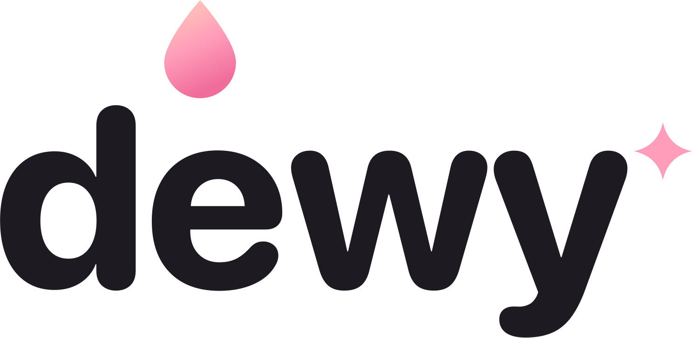

<p align="center">
  <picture>
    <source media="(prefers-color-scheme: dark)" srcset="art/brand/dewy-wordmark-white.png">
    
  </picture>
</p>

# Dewy

**Real-time beauty for OBS.** A face-aware beauty filter that runs natively inside OBS, as a
regular video filter, with no virtual camera. Skin smoothing, tone, face reshaping, makeup,
stickers, ambience, colour filters and virtual studio lighting, all controlled from one dock.


https://github.com/user-attachments/assets/15238be5-787a-48c5-b02a-7659ed85f954


<p align="center">The real Dewy dock in OBS: skin and reshape sliders, makeup, stickers, ambience, filters and light,
then one-click presets and saving your own look. Dewy on top, the original camera below.</p>


## Why Dewy

Most beauty filters paint over the skin: they blur it, then blend a skin colour on top. That's what
makes faces look flat and plastic, because the paint also covers the light and shadow that give a
face its shape.

Dewy edits skin the way skin actually works. In optical density, every skin pixel is
**melanin + hemoglobin + shading**, and Dewy calibrates the first two on *your* skin and *your*
camera every two seconds. Skin tone changes melanin. Foundation evens out melanin and hemoglobin
blotches. Redness removes excess hemoglobin. Makeup is deposited as a pigment layer. The
shading (your lighting, your shadows, the 3-D form of your face) is never touched. Measured, it
keeps 98–102 % of the original shadow depth; Dewy's own earlier paint-over version kept only 59–67 %.
The details are in [research/pigment/FINDINGS.md](research/pigment/FINDINGS.md).

## Features

| Tab | What it does |
|---|---|
| **Presets** | 26 one-click full looks (Everyday, Glam, Studio, Mood, Men) that set every tab at once, plus your own: save the current look in one click, right-click to rename or delete |
| **Enhance → Appearance** | Smooth (keeps pores and grain), Foundation, Skin tone (lighter / deeper), Redness, Shadows (dark circles), smile lines, teeth whitening, bright eyes, clarity, plus 27 reshape sliders for face, eyes, nose, mouth and brows |
| **Enhance → Makeup** | 15 looks, or build your own: lipstick and gloss, blush (3 placements), eyeshadow, eyeliner, contour, highlight, brow tint, colour grade and `.cube` LUTs |
| **Effects** | 23 face-tracked stickers and distortions (ears, glasses, crowns, freckles, …) |
| **Atmosphere** | 13 GPU particle ambiences and 6 camera-motion effects |
| **Filters** | 26 colour grades, baked to 3D LUTs at runtime |
| **Light** | 9 whole-body virtual lights (key, rim, fill, background dim) that follow your real silhouette |

- Every tab has its own on/off switch, and the dock's thumbnails are rendered from your own face.
- Landmarks are tracked frame-synchronised, so makeup and stickers stay stuck to your face.
- Skin edits use a learned segmenter (face skin, body skin, hair, clothes), so the neck and hands match
  the face, and walls, doors and shirts are never treated as skin.

## Install

There are no prebuilt releases yet. Build from source (below), then restart OBS.

1. The **Dewy** dock opens the first time (later: **Docks → Dewy**).
2. Pick your camera in the dock and press **Add Dewy to this source**, or add the **Dewy** filter to
   any video source from its Filters window.

**Requirements:** OBS Studio 33 and macOS on Apple Silicon (tested). The Windows build compiles
in CI but **hasn't been run on a Windows PC yet**, so expect fixes to be needed.

## Performance

Measured on an M4 Pro MacBook Pro with a 1080p30 camera in a 1080p60 OBS canvas. The extra cost
of the filter barely depends on which features are on:

| | Filter off | Dewy on (every tab active) |
|---|---|---|
| OBS render time per frame | 5.4 ms | 6.0–6.2 ms |
| OBS CPU | baseline | about +15 % of one core |
| GPU | baseline | about +7–9 % |
| Skipped frames | 0 | 0 |

Face tracking runs on Apple Vision, and segmentation runs mostly on the Neural Engine (Core ML via
ONNX Runtime), so little of the work competes with a game for the GPU.

## How it works

- **Face tracking.** On macOS, Apple Vision provides 76 landmarks with seeded tracking. The ONNX
  backend (Windows, or optionally macOS) runs MediaPipe Face Landmarker v2 (478 points) with
  OpenCV YuNet for re-detection. Both feed one portable core (`src/tracker/tracker-core.cpp`):
  One-Euro smoothing, frame history with interpolation, frame sync, and repeated-frame detection.
- **Segmentation.** MediaPipe's selfie multiclass model runs about 15 times a second. Its mask is
  snapped to the frame's real edges on the GPU with joint-bilateral upsampling.
- **Skin.** Frequency separation (base / blemish band / fine grain) handles smoothing. Colour
  edits (tone, foundation, redness, makeup) happen in optical density on the calibrated
  melanin and hemoglobin directions. See [research/pigment/](research/pigment/).
- **Everything else** is GPU shaders in OBS's own render pipeline (`data/effects/`): face warp,
  makeup, LUTs, particles and relighting.

[docs/RESEARCH.md](docs/RESEARCH.md) maps each control to the technique behind it.

## Build from source

### macOS (Apple Silicon)

Needs Xcode command-line tools, CMake 3.24+ and OBS Studio 33 installed in `/Applications`.

```sh
cmake -S . -B build -DCMAKE_BUILD_TYPE=RelWithDebInfo -DCMAKE_OSX_ARCHITECTURES=arm64
cmake --build build --target install-plugin   # installs into ~/Library/Application Support/obs-studio/plugins
```

The first configure downloads the OBS 33.0.0 headers, SIMDe, OBS's Qt 6.11 headers, ONNX Runtime
and the models into `.deps/` and `data/models/`. The plugin links against the frameworks inside
OBS.app.

### Windows x64 (builds in CI, not yet tested on a PC)

Needs Visual Studio 2022+ with the C++ workload, and CMake 3.24+.

```bat
cmake -S . -B build -A x64
cmake --build build --config Release
cpack --config build/CPackConfig.cmake -C Release -B dist
```

Unzip `dist/dewy-<version>-windows-x64.zip` into your OBS folder (`C:\Program Files\obs-studio`) so
that its `obs-plugins` and `data` folders merge. ONNX Runtime with DirectML ships renamed as
`dewy-onnxruntime.dll` and is loaded by full path, so it can't clash with another plugin's copy.

To try the ONNX tracking backend on macOS: `cmake -S . -B build-onnx -DBEAUTY_TRACKER=onnx`.

## Development

`tools/obsctl.py` drives OBS through obs-websocket. It reads the password from OBS's own config.

```sh
python3 tools/obsctl.py set "Video Capture Device" smooth=80 eye_size=40
python3 tools/obsctl.py reload "Video Capture Device"     # after editing .effect files
python3 tools/obsctl.py shot "Video Capture Device" out.png 1280
```

- Shader edits only need `install-plugin` followed by `reload`, because effects are compiled from
  source and bypass libobs's effect cache.
- C, Objective-C and preset JSON changes need an OBS restart.
- To render every dock tab to PNG, create
  `~/Library/Application Support/obs-studio/plugin_config/dewy/snapshot/` and restart OBS.

### Automating the dock

Dewy registers an obs-websocket vendor, `dewy`, so scripts, Stream Deck or demo tools can drive the dock
(the filter's settings themselves are set with the regular `SetSourceFilterSettings`):

```json
{"requestType": "CallVendorRequest", "requestData": {"vendorName": "dewy", "requestType": "show",
  "requestData": {"tab": "atmosphere", "sub": "motion"}}}
{"requestType": "CallVendorRequest", "requestData": {"vendorName": "dewy", "requestType": "focus",
  "requestData": {"target": "face_slim"}}}
```

- `show`: `tab` is `enhance`, `effects`, `atmosphere`, `filters` or `light`. The optional `sub` is
  `appearance`, `makeup`, `customise`, `ambience` or `motion`.
- `focus` brings a control into view. `target` is a slider key (`smooth`, `face_slim`, `eye_size`, …),
  `look:<name>` (`look:Rose`), `preset:<name>`, `mypreset:<name>`, or `<setting>:<preset>`
  (`effect_preset:Kitty`, `atmo_preset:Sparkles`, `filter_preset:Fresh`, `light_preset:Neon`).
  The response is `{"ok": true}` when the target exists.
- `apply` applies a full look: `{"target": "preset:Golden Hour"}` or `{"target": "mypreset:My look 1"}`.
  Handy on a Stream Deck button.
- `save` saves the current look as a new preset, `reset` presses Reset on the current tab, and
  `tabs_scroll` (`{"dir": 1}`) scrolls the tab strip.
- `locate` returns where a control is on screen (`x`, `y`, `w`, `h`, plus `kx`, `ky` for a slider's knob).
  It's used to script demo videos.

### Adding content

- **Filters:** add an entry to `data/filters.json` (exposure, contrast, curve, saturation, vibrance,
  warmth, tint, hue, fade, rolloff, per-channel gamma, shadows / highlights, mono).
- **Stickers:** draw an SVG in `art/stickers/`, render it to `data/stickers/<name>.png`, and add an
  effect to `data/effects.json`. Sprites anchor to `eyes`, `eye_l`, `eye_r`, `nose`, `mouth`, `chin`,
  `forehead`, `head_top`, `cheek_l` or `cheek_r`, with offsets and widths in eye-distance units, an
  optional `anim` (bob, pulse, spin, sway, twinkle) and `blend` (normal, add, multiply).
- **Lights and ambiences:** `data/lights.json` and `data/atmosphere.json`.
- **Presets:** `data/looks.json`. A look lists only the settings it changes; everything else is reset
  to its default when the look is applied.

### Project layout

```
src/beauty-filter.c        the OBS filter: passes, uniforms, tracking hand-off
src/tracker/               face tracking, segmentation, pigment calibration
src/dock/                  the Qt dock (no moc)
data/effects/              GPU shaders
data/*.json, data/makeup/  presets (looks.json: the Presets tab)
art/brand/                 the Dewy logo (SVG sources and PNGs)
research/pigment/          the pigment-model prototype and its findings
tests/                     tracking jitter / lag harnesses (need updating for the current tracker)
```

## Roadmap

- Prebuilt releases for macOS
- Test the Windows build on real hardware
- Validate the pigment model across a wide range of skin tones
- Multiple faces, Linux

## Credits

- [OBS Studio](https://obsproject.com) (GPL-2.0)
- [ONNX Runtime](https://onnxruntime.ai) (MIT)
- Google MediaPipe Face Landmarker and selfie segmentation models (Apache-2.0)
- OpenCV YuNet (MIT)

Model sources and licenses are listed in [data/models/NOTICE.md](data/models/NOTICE.md). The pigment
model follows Tsumura et al., *Image-based skin color and texture analysis/synthesis by extracting
hemoglobin and melanin information in the skin* (SIGGRAPH 2003).

Dewy is an independent project, not affiliated with streaming-app or OBS.

## License

GPL-2.0-or-later, the same as OBS Studio. See [LICENSE](LICENSE).
